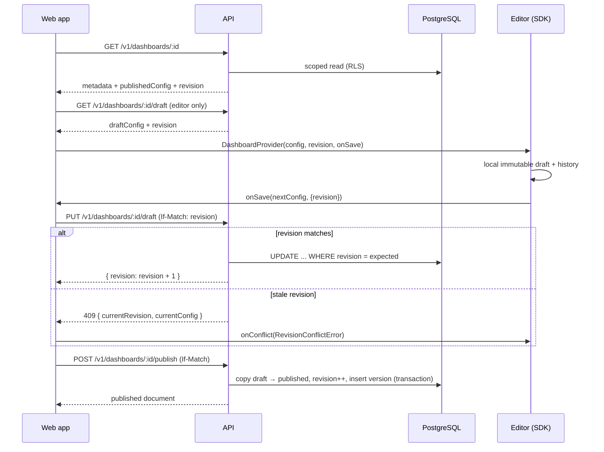

# Data Flow

**Status:** Implemented. The editor save/publish/restore and viewer read paths
landed in M4, M5 added widget rendering, M6 moved the store to PostgreSQL with
per-request tenant scoping and row-level security, M7 added connector-backed
query execution with limits and truncation, and M8 added `/ws/v1` and
`GET /v1/stream` with sequences, replay, throttling and SDK connection managers.
Version restore copies into the draft without publishing.

## Editor: load, edit, save, publish



Rules:

- Local edits live in Zustand inside `dashboard-builder`; they are not server state.
- Every save carries the last known `revision`. The server rejects stale writes;
  the editor surfaces a conflict workflow and never silently overwrites.
- Publishing copies the draft into the published configuration, increments the
  revision, records an immutable version and prunes history to 50, atomically.
- Saving a draft never changes what viewers see.

## Conflict workflow

1. Save returns `409` with `currentRevision` and optionally `currentConfig`.
2. The editor shows a conflict panel: keep mine, take theirs, or open a diff.
3. "Keep mine" retries with the new revision after explicit confirmation.
4. "Take theirs" replaces local config and clears history.
5. No automatic merge is attempted in v1.

## Viewer: read the published configuration

```text
GET /v1/dashboards/:id
  → publishedConfig (never draftConfig)
  → SDK DashboardViewer
  → widgets resolve queries through DataAdapter
```

Viewers never receive the draft endpoint data. If a dashboard has never been
published, the viewer shows an "unpublished" state rather than the draft.

## Query flow (snapshots)

```text
Widget query definition
  → SDK resolves variables, filters, time range (buildControlledQueryRequest)
  → POST /v1/queries/execute
  → authorization (viewer's effective permissions + data-source scope)
  → limits (15 s, 10,000 rows, 5 MiB)
  → data-source plugin
  → external system
  → QueryResult
  → TanStack Query cache keyed by [dataSourceId, queryId, params, timeRange]
  → widget
```

- Cache deduplicates identical requests from multiple widgets.
- The cache key covers the fully resolved request, so changing a variable,
  filter or the dashboard time range refetches only the affected widgets.
  Relative ranges resolve against a pinned clock in the key so a dashboard
  that has not changed does not refetch on every render.
- Refresh interval comes from dashboard settings; a widget may override within
  policy.
- Cancellation aborts the upstream execution.
- Truncated results set `meta.truncated` and are surfaced in the widget.

## Control and interaction flow (M9)

```text
Time-range preset | variable edit | chart point click
  → runtime controls state (viewer/editor mount, never persisted)
  → setVariable writes the raw category value from widget.interaction.variable
  → buildControlledQueryRequest merges variables, filters and range
  → query cache key changes for affected widgets only
  → hidden widgets (visibility grammar false) are not rendered and do not fetch
```

Dashboard filters only join queries whose `fields` include the filtered field.
Export/import moves the configuration, not control state: imported dashboards
start from variable defaults.

## Widget rendering (M5)

```text
QueryResult (ready | loading | error | idle)
  → widget projects rows (toSeries / latestValue, optional field overrides)
  → empty? → "no data" state
  → chart widget → buildOption(colors, animation) with resolved tokens
  → EChart host → ECharts canvas (init after layout, resize on container change)
  → table widget → formatted rows, capped at maxRows
  → truncated? → disclosure note
```

- Charts paint CSS tokens resolved from the mounted element; a `data-theme`
  change re-resolves them without remounting the chart.
- Animation is disabled when `prefers-reduced-motion` matches.
- Settings commits are validated against the widget `configSchema` before the
  draft changes; rejected values render an inline notice and never persist.
- The viewer and editor run the same widget components; only the surrounding
  layout engine differs.

## Stream flow

```text
External source
  → server-side connector
  → realtime gateway assigns sequence
  → /ws/v1 data events (throttled to 250 ms for stream mode)
  → shared SDK connection manager
  → subscription registry → per-subscription bounded ring buffer
  → widget (at most 4 UI updates/sec)
```

- Stream data does not enter TanStack Query as raw events; `snapshot-then-stream`
  snapshots do replace the cached query result so charts and KPIs update live.
- A snapshot replaces state after connect or gap.
- Duplicate sequences are ignored; out-of-order sequences trigger gap recovery
  and a cache refetch.
- The server re-executes the query on `REALTIME_POLL_INTERVAL_MS` (default 5 s)
  because connectors are pull-based today; the hub shares one poller per
  organization + request.
- The web app uses SSE through `/api` unless `NEXT_PUBLIC_NAMA_WS_URL` points at
  the WebSocket gateway.

## Migration points

| Point | Migration |
| --- | --- |
| Dashboard load (`GET`) | Dashboard `schemaVersion` and widget `configVersion` migrations |
| Import | Envelope validation, migrations, cap checks |
| Save | Validate the current version; never write an older schemaVersion |
| Render | Unsupported widget version → placeholder, data preserved |

Migrations are idempotent and tested for every supported version. Migration
results may be cached per `(dashboardId, revision)`.

## Undo and redo

- History is local to the draft, bounded to 50 entries.
- Immutable transitions; a drag/resize gesture is one entry.
- An entry records the edited breakpoint, not all breakpoints.
- Publish or version restore clears history.
- History is never sent to the backend.

## Version restore

```text
GET /v1/dashboards/:id/versions
  → select a version
POST /v1/dashboards/:id/restore { versionId } (If-Match)
  → server writes version config as the new draft
  → revision increments
  → history clears
```

Restore never mutates the immutable version row and never publishes implicitly.

## Import and export

- Export: config + envelope (`schemaVersion`, `exportedAt`, app version).
- Import: validate envelope → migrate → validate → cap check → regenerate IDs →
  save as draft.
- Unknown widget types are preserved as placeholders.

## Time and timezone

- All persisted timestamps are UTC ISO-8601.
- Display timezone resolution: user preference → dashboard setting → organization
  default.
- Relative time ranges (`last 24h`) are resolved at execution time using the
  resolved timezone.

## Related documents

- [dashboard-schema.md](dashboard-schema.md)
- [data-source-contracts.md](data-source-contracts.md)
- [realtime-protocol.md](realtime-protocol.md)
- [backend-architecture.md](backend-architecture.md)
- [decisions/ADR-002-dashboard-schema.md](decisions/ADR-002-dashboard-schema.md)
