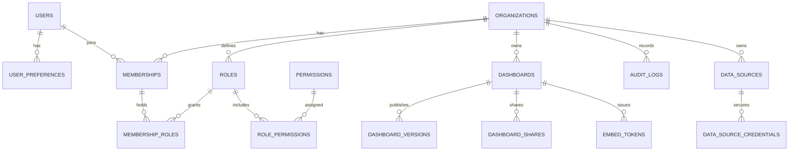

# Data Model

**Status:** Proposed (M0). Prisma models and migrations are created in M6.

## Principles

- PostgreSQL stores product metadata, dashboard configurations and version
  history. High-volume telemetry stays in external/time-series systems.
- IDs are UUIDv7 (sortable, generated by the application or database function).
- Timestamps are UTC (`timestamptz`). Display timezone is a presentation concern.
- Every organization-owned table has a non-null `organization_id` and RLS
  (ADR-008).
- Dashboard configuration is JSONB; ownership, permissions, versions and audit
  are relational.
- Credentials are encrypted at rest and never stored in dashboard JSON.

## Entity relationship diagram



## Entities

### User

| Column | Type | Notes |
| --- | --- | --- |
| `id` | uuid (v7) | PK |
| `email` | text | unique, case-insensitive index |
| `password_hash` | text | Argon2id; nullable until first credential set |
| `display_name` | text | |
| `status` | enum | `active`, `disabled` |
| `created_at`, `updated_at` | timestamptz | UTC |

Users are global; organization membership is separate.

### UserPreference

| Column | Type | Notes |
| --- | --- | --- |
| `user_id` | uuid | PK, FK users |
| `locale` | text | `en` or `fa` |
| `theme` | text | `light`, `dark`, `system` |
| `timezone` | text | IANA zone |
| `default_organization_id` | uuid | nullable |

### Organization

| Column | Type | Notes |
| --- | --- | --- |
| `id` | uuid (v7) | PK |
| `name` | text | |
| `slug` | text | unique |
| `created_at`, `updated_at` | timestamptz | |

### Membership

| Column | Type | Notes |
| --- | --- | --- |
| `id` | uuid (v7) | PK |
| `organization_id` | uuid | FK, indexed |
| `user_id` | uuid | FK |
| `status` | enum | `invited`, `active`, `suspended` |
| `created_at` | timestamptz | |

Unique `(organization_id, user_id)`.

### Role, Permission, RolePermission, MembershipRole

- `roles`: org-scoped (`organization_id`), `name`, `is_system`, timestamps.
- `permissions`: global catalog (`dashboard.read`, `dashboard.update`, …).
- `role_permissions`: `(role_id, permission_id)` join.
- `membership_roles`: `(membership_id, role_id)` join, supports custom
  combinations.

System roles: owner, administrator, editor, viewer, data-source administrator.
Custom roles are organization-defined sets of permissions.

### Dashboard

| Column | Type | Notes |
| --- | --- | --- |
| `id` | uuid (v7) | PK |
| `organization_id` | uuid | FK, indexed |
| `name` | text | |
| `draft_config` | jsonb | `DashboardConfig` |
| `published_config` | jsonb | nullable until first publish |
| `revision` | integer | optimistic concurrency; starts at 1 |
| `created_by` | uuid | FK users |
| `created_at`, `updated_at`, `published_at` | timestamptz | UTC |

Index: `(organization_id, updated_at desc)`. Dashboard configuration caps:
1 MiB, 100 widgets (validated in service layer).

### DashboardVersion

| Column | Type | Notes |
| --- | --- | --- |
| `id` | uuid (v7) | PK |
| `dashboard_id` | uuid | FK, indexed |
| `organization_id` | uuid | for RLS |
| `revision` | integer | revision created by this publish |
| `config` | jsonb | immutable published snapshot |
| `created_by` | uuid | |
| `created_at` | timestamptz | |

Retention: last **50** versions per dashboard, pruning policy is configuration,
not hardcoded. Restore reads a version and writes it as a new draft (never
mutates the version row).

### DashboardShare

| Column | Type | Notes |
| --- | --- | --- |
| `id` | uuid (v7) | PK |
| `dashboard_id` | uuid | FK |
| `organization_id` | uuid | RLS |
| `subject_type` | enum | `user`, `role`, `organization` |
| `subject_id` | uuid | |
| `permission` | enum | `view`, `edit` |
| `created_at` | timestamptz | |

Sharing is organization-scoped in v1; there are no anonymous public links.

### DataSource

| Column | Type | Notes |
| --- | --- | --- |
| `id` | uuid (v7) | PK |
| `organization_id` | uuid | FK, indexed |
| `name` | text | |
| `kind` | text | `postgres`, `mysql`, `rest`, `mqtt`, `static` |
| `config` | jsonb | non-secret connection metadata |
| `allow_raw_sql` | boolean | default false |
| `limits` | jsonb | per-source tightening of platform limits |
| `status` | enum | `active`, `disabled`, `error` |
| `created_at`, `updated_at` | timestamptz | |

### DataSourceCredential

| Column | Type | Notes |
| --- | --- | --- |
| `id` | uuid (v7) | PK |
| `data_source_id` | uuid | FK, unique |
| `organization_id` | uuid | RLS |
| `ciphertext` | bytea | encrypted with a managed key |
| `key_version` | integer | supports rotation |
| `created_at`, `rotated_at` | timestamptz | |

Credentials are never returned by the API and never logged.

### WidgetDefinition

| Column | Type | Notes |
| --- | --- | --- |
| `id` | uuid (v7) | PK |
| `type` | text | unique |
| `manifest` | jsonb | id, version, name, description, capabilities |
| `config_version` | integer | supported config version |
| `is_builtin` | boolean | |
| `created_at`, `updated_at` | timestamptz | |

Built-in widget definitions may be seeded from code; the table lets
organizations see available widgets through `/v1/widgets`.

### EmbedToken

| Column | Type | Notes |
| --- | --- | --- |
| `id` | uuid (v7) | PK |
| `dashboard_id` | uuid | FK |
| `organization_id` | uuid | RLS |
| `token_hash` | bytea | SHA-256; unique; plaintext never stored |
| `issued_by` | uuid | FK users |
| `viewer_identity` | text | optional |
| `scope` | jsonb | dashboard IDs, pre-bound variables/filters |
| `expires_at` | timestamptz | |
| `revoked_at` | timestamptz | nullable |
| `created_at` | timestamptz | |

Details in [ADR-009](decisions/ADR-009-embed-tokens.md).

### AuditLog

| Column | Type | Notes |
| --- | --- | --- |
| `id` | uuid (v7) | PK |
| `organization_id` | uuid | RLS |
| `actor_type` | enum | `user`, `embed`, `system` |
| `actor_id` | uuid/text | |
| `action` | text | e.g. `dashboard.publish`, `datasource.update` |
| `resource_type`, `resource_id` | text/uuid | |
| `metadata` | jsonb | no secrets or token values |
| `request_id` | text | correlates with logs |
| `created_at` | timestamptz | indexed |

Retention is configuration with a documented default (365 days proposed).

## Row-level security

Every organization-owned table follows this pattern:

```sql
ALTER TABLE dashboards ENABLE ROW LEVEL SECURITY;
ALTER TABLE dashboards FORCE ROW LEVEL SECURITY;

CREATE POLICY tenant_isolation ON dashboards
  USING (organization_id = current_setting('app.organization_id')::uuid)
  WITH CHECK (organization_id = current_setting('app.organization_id')::uuid);
```

Each request transaction sets:

```sql
SET LOCAL app.organization_id = '<uuid>';
SET LOCAL app.user_id = '<uuid>';
```

Rules:

- The application role does not have `BYPASSRLS`.
- Connection pooling must not leak session settings; `SET LOCAL` is used inside
  the transaction and the transaction is the unit of work.
- Background jobs use an explicit privileged connection with audit, not ambient
  bypass.
- New tables require a policy, an index on `organization_id`, and a cross-tenant
  test in CI.

## Indexes (initial)

- `users (lower(email))` unique
- `memberships (organization_id, user_id)` unique
- `dashboards (organization_id, updated_at desc)`
- `dashboard_versions (dashboard_id, created_at desc)`
- `dashboard_shares (dashboard_id, subject_type, subject_id)` unique
- `data_sources (organization_id, name)`
- `embed_tokens (token_hash)` unique, `(dashboard_id, expires_at)`
- `audit_logs (organization_id, created_at desc)`

## Migration policy

- The API owns migrations; they run as a release step with a documented
  rollback path.
- Destructive changes use expand/contract.
- JSONB schema changes are application-level migrations (`schemaVersion`), not
  database column changes.
- Version retention and audit retention are configuration values with documented
  defaults.

## Related documents

- [dashboard-schema.md](dashboard-schema.md)
- [backend-architecture.md](backend-architecture.md)
- [security.md](security.md)
- [decisions/ADR-008-tenant-isolation-rls.md](decisions/ADR-008-tenant-isolation-rls.md)
