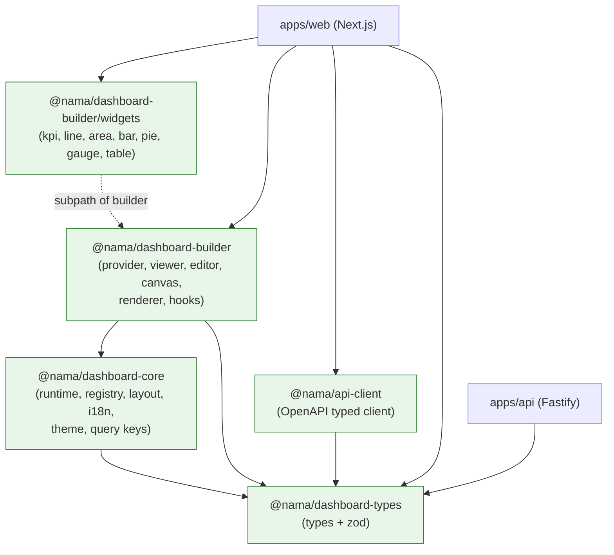

# Package Dependencies

**Status:** Implemented through M6 (2026-11-12)

## Initial packages (created in M1)

| Package | Responsibility | Runtime dependencies | Peer dependencies |
| --- | --- | --- | --- |
| `@nama/dashboard-types` | Public types and Zod schemas for dashboard config, widgets, layout, queries, realtime events, plugin manifests | `zod` | — |
| `@nama/dashboard-core` | Host-agnostic runtime: registries, widget resolution, layout helpers, i18n, theme tokens, query helpers | `@nama/dashboard-types`, `zod` | `react` (types only) |
| `@nama/dashboard-builder` | Public React API and UI: provider, viewer, renderer, hooks, editor, stylesheet; built-in widgets behind the `./widgets` subpath | `@nama/dashboard-types`, `@nama/dashboard-core`, `@tanstack/react-query`, `zustand`, `react-grid-layout`, `zod`, `echarts` | `react`, `react-dom` |
| `@nama/api-client` | Typed HTTP transport for the platform API: requests, cookie/CSRF handling, `ApiError` mapping | `@nama/dashboard-types` (query types) | — |

Rules:

- Dependencies are introduced with the code that uses them (M3–M5); M1 installed
  only what the foundation needed.
- **M3 decision:** TanStack Query lives in `dashboard-builder`, not
  `dashboard-core`. Core must stay free of React runtime imports; caching and
  hooks are React concerns. `zustand` (editor state), `react-grid-layout`
  (M4 canvas) and `echarts` + `zod` (M5 widgets) follow the same rule. Whichever
  package owns the code owns the dependency.
- **M4 state:** the editor moved into `dashboard-builder`, so `zustand` and
  `react-grid-layout` are builder runtime dependencies and `apps/web` no longer
  owns editor state. `apps/web` links `builder`, `dashboard-types` and
  `api-client`; `apps/api` runs on `fastify`, `@fastify/cookie`,
  `@node-rs/argon2`, `zod` and `dashboard-types`.
- **M5 state:** the built-in widgets live in `dashboard-builder` but are exposed
  through the separate `./widgets` entry, and `echarts` is a builder runtime
  dependency. The main entry must not import ECharts; `verify:consumer` budgets
  both entries.
- React and React DOM are **peer dependencies** of every React package to avoid
  duplicate React copies.
- No package imports from `apps/web` or `apps/api`.
- The API may depend on `dashboard-types` for shared request/response shapes, but
  never on React packages.
- `zustand` is an internal implementation detail of the editor; it is not
  re-exported as public API. Hooks and components are the supported surface.

## Target-only packages (not created in M1)

| Package | Would own | Split trigger |
| --- | --- | --- |
| `dashboard-schemas` | Zod schemas split out of types | Schemas evaluated independently of types |
| `dashboard-layout` | Grid and responsive layout logic | A second consumer of layout math |
| `dashboard-widgets` | Built-in widget implementations | Widget package gains its own release cadence |
| `dashboard-data` | Query manager and adapter contracts | Non-React data consumers appear |
| `dashboard-realtime` | Shared connection manager | Realtime used outside the dashboard runtime |
| `dashboard-ui` | Builder-specific UI primitives | UI kit reused by another product surface |
| `dashboard-i18n` | Translation and direction interfaces | More locales or a standalone i18n package |
| `dashboard-theme` | Theme tokens and provider | Theme consumed by a non-SDK surface |
| `plugin-sdk` | Public plugin contracts | Third-party plugin authors need a stable package |
| `eslint-config` / `tsconfig` | Shared tooling configuration | M1 tooling setup |

## Dependency graph



**Edges that must never exist:**

- `types` → `core`, `builder`, `api-client`, or any app
- `core` → `builder` or any app
- `builder` → `api-client` (the host injects the adapter)
- the `builder` main entry → `echarts` (charts live behind `./widgets` only)
- any package → `apps/web` or `apps/api`
- `apps/api` → any React package
- any cycle, including dev-only cycles

## Workspace configuration

```yaml
# pnpm-workspace.yaml (M1)
packages:
  - "apps/*"
  - "packages/*"
```

Shared TypeScript (`tsconfig.base.json`) and ESLint (`eslint.config.mjs`) live at
the repository root rather than in `tooling/*` packages, so the workspace keeps
exactly four internal packages. A `tooling/*` package is created only if a
configuration needs to be consumed outside this repository.

- Internal dependencies use `workspace:*`.
- Turborepo tasks: `build`, `dev`, `lint`, `typecheck`, `test`, `clean`.
  `lint` runs once at the root over every workspace file.
- `build` depends on upstream package builds (`dependsOn: ["^build"]`).
- `dev` also depends on `^build`, so a cleaned workspace starts without missing
  package output.
- `typecheck` and `test` depend on `^build` because packages resolve to `dist`.
- The Next.js bundler workspace root is configured explicitly
  (`turbopack.root`) so dependencies resolve from the workspace root.

Task graph as implemented in `turbo.json`:

```json
{
  "tasks": {
    "build": { "dependsOn": ["^build"], "outputs": ["dist/**", ".next/**", "!.next/cache/**"] },
    "dev": { "dependsOn": ["^build"], "cache": false, "persistent": true },
    "typecheck": { "dependsOn": ["^build"] },
    "test": { "dependsOn": ["^build"] },
    "clean": { "cache": false }
  }
}
```

## Build and distribution

- Packages build with `tsdown` to ESM plus declarations.
- The build must preserve `"use client"` directives; CI fails when a built file
  that had the directive loses it. The builder emits the directive once via the
  `tsdown` banner rather than per source module, because rolldown warns that
  module-level directives are not preserved when bundling and only the entry
  directive is meaningful to consumers.
- CSS ships through explicit exports (`@nama/dashboard-builder/styles.css`,
  copied to `dist/styles.css` by the build).
- React/React DOM are peer dependencies; `pnpm why react` in the consumer test
  must show one copy.
- Distribution is private-workspace only in v1. The consumer test packs the
  tarball with the package manager's `pack` command and installs it in a separate
  React/Next.js application. No registry or publish pipeline exists yet.
- The SDK entry point has a gzipped bundle budget, set in M3: 10 KiB for the
  builder entry (5.1 KiB at M3), enforced by `pnpm verify:consumer`.

## Consumer test

`pnpm verify:consumer` packs the three SDK packages, installs the tarballs
offline into a throwaway React app built from
`examples/standalone-consumer`, server-renders a dashboard with a custom widget
and verifies:

- Package exports and type declarations resolve.
- CSS loads.
- `"use client"` survives the build.
- SSR/build succeeds with `cacheComponents` enabled in the host.
- React is not duplicated.
- No monorepo source alias is required.
- A custom widget can be registered through the documented API.
- The builder entry stays under the gzipped bundle budget.

## Related documents

- [overview.md](overview.md)
- [decisions/ADR-001-monorepo.md](decisions/ADR-001-monorepo.md)
- [sdk-api.md](sdk-api.md)
- [dependency-license-review.md](dependency-license-review.md)
