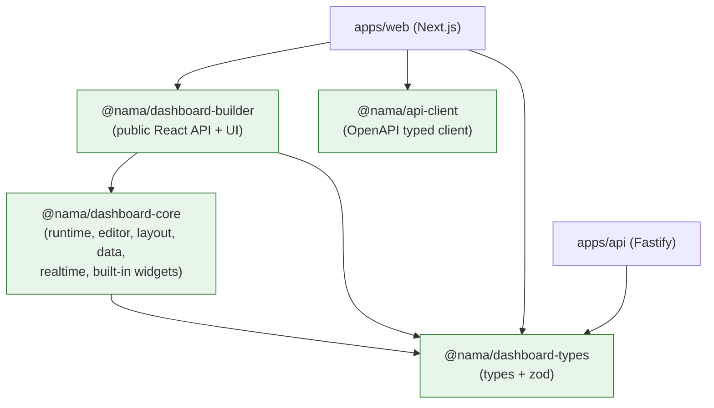

# Package Dependencies

**Status:** Proposed (M0)

## Initial packages (created in M1)

| Package | Responsibility | Runtime dependencies | Peer dependencies |
| --- | --- | --- | --- |
| `@nama/dashboard-types` | Public types and Zod schemas for dashboard config, widgets, layout, queries, realtime events, plugin manifests | `zod` | — |
| `@nama/dashboard-core` | Runtime, editor engine, registries, layout integration, data query manager, realtime manager, built-in widgets | `@nama/dashboard-types`, `zod`, `zustand`, `@tanstack/react-query`, `react-grid-layout`, `echarts` | `react`, `react-dom` |
| `@nama/dashboard-builder` | Public React API and builder UI (provider, viewer, editor, canvas, toolbar, panels) | `@nama/dashboard-types`, `@nama/dashboard-core` | `react`, `react-dom` |
| `@nama/api-client` | OpenAPI-generated typed client; transport, auth injection, error handling | none at runtime beyond `fetch` | — |

Rules:

- React and React DOM are **peer dependencies** of every React package to avoid
  duplicate React copies.
- No package imports from `apps/web` or `apps/api`.
- The API may depend on `dashboard-types` for shared request/response shapes, but
  never on React packages.
- `zustand` is an internal implementation detail of `dashboard-core`; it is not
  re-exported as public API.

## Target-only packages (not created in M1)

| Package | Would own | Split trigger |
| --- | --- | --- |
| `dashboard-schemas` | Zod schemas split out of types | Schemas evaluated independently of types |
| `dashboard-layout` | Grid and responsive layout logic | A second consumer of layout math |
| `dashboard-widgets` | Built-in widget implementations | Widget package gains its own release cadence |
| `dashboard-data` | Query manager and adapter contracts | Non-React data consumers appear |
| `dashboard-realtime` | Shared connection manager | Realtime used outside the dashboard runtime |
| `dashboard-ui` | Builder-specific UI primitives | UI kit reused by another product surface |
| `dashboard-i18n` | Translation and direction interfaces | More locales or a standalone i18n package |
| `dashboard-theme` | Theme tokens and provider | Theme consumed by a non-SDK surface |
| `plugin-sdk` | Public plugin contracts | Third-party plugin authors need a stable package |
| `eslint-config` / `tsconfig` | Shared tooling configuration | M1 tooling setup |

## Dependency graph



**Edges that must never exist:**

- `types` → `core`, `builder`, `api-client`, or any app
- `core` → `builder` or any app
- `builder` → `api-client` (the host injects the adapter)
- any package → `apps/web` or `apps/api`
- `apps/api` → any React package
- any cycle, including dev-only cycles

## Workspace configuration

```yaml
# pnpm-workspace.yaml (target, M1)
packages:
  - "apps/*"
  - "packages/*"
  - "tooling/*"
```

- Internal dependencies use `workspace:*`.
- Turborepo tasks: `build`, `dev`, `lint`, `typecheck`, `test`, `clean`.
- `build` depends on upstream package builds (`dependsOn: ["^build"]`).
- `typecheck` depends on `^build` when packages consume generated declarations.
- The Next.js bundler workspace root is configured explicitly so dependencies
  resolve from the workspace root in the monorepo.

Suggested task graph:

```json
{
  "tasks": {
    "build": { "dependsOn": ["^build"], "outputs": ["dist/**", ".next/**"] },
    "dev": { "cache": false, "persistent": true },
    "lint": { "dependsOn": ["^build"] },
    "typecheck": { "dependsOn": ["^build"] },
    "test": { "dependsOn": ["^build"], "outputs": ["coverage/**"] },
    "clean": { "cache": false }
  }
}
```

## Build and distribution

- Packages build with `tsdown` to ESM plus declarations.
- The build must preserve `"use client"` directives; CI fails when a built file
  that had the directive loses it.
- CSS ships through explicit exports (`@nama/dashboard-builder/styles.css`).
- React/React DOM are peer dependencies; `pnpm why react` in the consumer test
  must show one copy.
- Distribution is private-workspace only in v1. The consumer test packs the
  tarball with the package manager's `pack` command and installs it in a separate
  React/Next.js application. No registry or publish pipeline exists yet.
- The SDK entry point has a gzipped bundle budget, set in M3 and enforced by the
  build.

## Consumer test

The separate test application verifies:

- Package exports and type declarations resolve.
- CSS loads.
- `"use client"` survives the build.
- SSR/build succeeds with `cacheComponents` enabled in the host.
- React is not duplicated.
- No monorepo source alias is required.
- A custom widget can be registered through the documented API.

## Related documents

- [overview.md](overview.md)
- [decisions/ADR-001-monorepo.md](decisions/ADR-001-monorepo.md)
- [sdk-api.md](sdk-api.md)
- [dependency-license-review.md](dependency-license-review.md)
